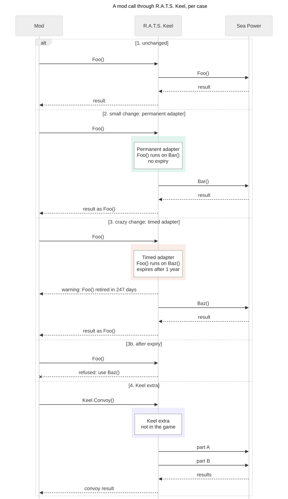

# Keel as the interface between mods and Sea Power

- Mods call only the stable Keel API; Keel talks to the game
- Small game change: permanent adapter, stays for years
- Crazy game change: timed adapter, about 1 year, then retired (Keel warns the modder)
- Keel extras: features the game lacks, built by Keel from game parts
- `Foo` / `Bar` / `Baz` / `Convoy` are placeholders, not real game functions
- Part of Wave 3 of the [roadmap](../ROADMAP.md)

## Component

## A call through Keel, per case

## Life of a Keel API function

## Editing

- The `.mmd` files are [Mermaid](https://mermaid.js.org) code; GitHub and Obsidian draw them as they are
- Pictures: `mmdc -i state.mmd -o state.svg` ([Mermaid CLI](https://github.com/mermaid-js/mermaid-cli)), `-s 3` for a sharp PNG
