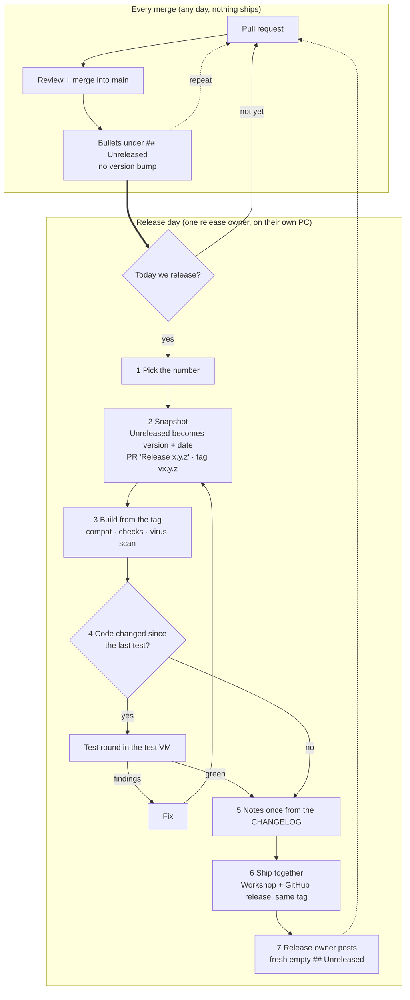

# Releases: merge often, release on purpose

Merging only collects work. A release is a snapshot we choose to make: it gets a version, one set of notes, a post, and goes to
the Steam Workshop and GitHub together.

## Every merge

- Merge into `main` as often as needed; nothing ships.
- Each PR adds its bullets under `## Unreleased` at the top of [CHANGELOG.md](../../CHANGELOG.md).
- **No version bump in a PR**: the version in the code and the CHANGELOG headings stay at the last release.
- No virus scan in a PR: it runs on release day.

## Release day

One release owner runs it on their own PC, start to finish.

| # | Step | What |
|---|---|---|
| 1 | Decide | "Today we release", who owns it, the number (table below) |
| 2 | Snapshot | `## Unreleased` becomes `## x.y.z - <date>`; version set in the code; one PR "Release x.y.z", merged; tag `vx.y.z` |
| 3 | Build + checks from the tag | build against the game's current main branch; compatibility check against the game's code; every program file through VirusTotal |
| 4 | Test round | one run in the test VM when code changed since the last tested build; findings get fixed, then back to step 2 with the same number |
| 5 | Notes once | from the CHANGELOG bullets: GitHub release, Workshop change note, post with a picture |
| 6 | Ship together | Workshop upload of the package built from the tag; GitHub release of the same tag right after |
| 7 | Tell people | the release owner posts (Discord `#announcements`, Reddit, Steam); replies to the issues it fixed; `main` gets a fresh empty `## Unreleased` |

## Which number

| Bump | When |
|---|---|
| x.y.**z+1** | only fixes |
| x.**y+1**.0 | new features or settings |
| **x+1**.0.0 | breaks something for players or mod authors (saves, settings, API) |

## Never

- Bump the version in a normal PR.
- Upload a build that is not from a release tag.
- Ship to the Workshop without the GitHub release, or the other way round.
- Skip the compatibility check or the virus scan on release day.
- Claim a game version works before it ran in the test VM.
