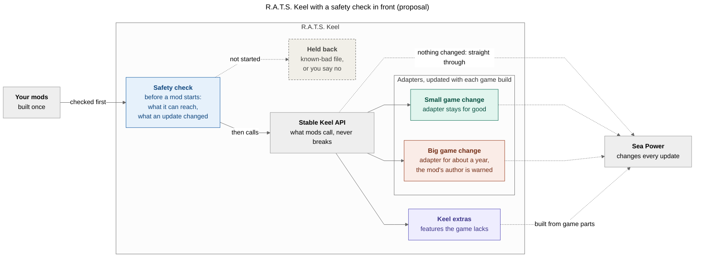

# Pre-analysis: a safety check for the mods Keel loads

- **Status: pre-analysis.** Nothing here is decided or built. It lists what Keel could do, what each option catches and what it costs.
- It belongs to the Wave 2 step "Safety check at load" of the [roadmap](../community/ROADMAP.md).
- It is not a proposal yet: a proposal follows only if one of the options is picked.

## Bottom line

- **A classic virus scan is the weakest piece.** Scanners know malware they have seen; a mod written to attack one game is new to all of them.
- **What works:** showing what a mod can reach, watching updates, and a list of known-bad files.
- **Nothing here makes a mod safe.** A code mod runs inside the game with the game's rights. Keel can make that visible, it cannot fence it in.
- **The stake is the whole mod scene.** After a worm spread through People Playground's Workshop in September 2026, every Workshop item of that game with C# code was removed (the developer's account, see Sources).

## The threat

| Case | How it works | Seen in |
|---|---|---|
| Poisoned update | An update to a mod players already trust carries the malware (the author's account was taken over, or the author's PC infected); auto-update delivers it | Downfall (2023), People Playground (September 2026) |
| Bait mod | A new mod promises something and does damage once it is switched on | People Playground "FPS++" (February 2026) |
| Steam account abuse | The mod publishes, votes and resets stats as the player; Sea Power ships a Steam library (Steamworks.NET) that mod code can call | People Playground (both cases) |
| The loader itself | Keel updates through the Workshop like any mod | No case; see Risks |

## Where it sits

## Options

| # | Option | Catches | Misses | Cost | Needs a server |
|---|---|---|---|---|---|
| A | **Capability check**: list what each DLL can reach (start programs, the network, files outside the game, the registry, code loaded from bytes, native calls, Steam calls) | New malware no scanner knows | Code hidden behind reflection or obfuscation | Small: Keel already reads every DLL before loading it | No |
| B | **Update watch**: remember each DLL's hash; a changed one shows what is new ("this update now starts programs") and can wait for the player's OK | Poisoned updates | A mod that was bad from its first version | Small: What's new already compares with the last start | No |
| C | **Steam guard**: when a mod calls Workshop publish, vote or stats reset, Keel asks the player first | The worm pattern | A mod that calls Steam's native library directly (A lists that) | Small to medium | No |
| D | **VirusTotal link**: one click from the report window to a mod file's VirusTotal page | Known malware, on demand | Anything new | Tiny | No |
| E | **Known-bad list**: a public list of confirmed malware hashes; Keel reads it at start and does not start those files | An outbreak, within minutes | Anything not yet reported | Small in code, real work in the process | A static file |
| F | **Scan service**: a job downloads new Sea Power Workshop DLLs, sends them to VirusTotal and publishes the results as a list Keel reads | Known malware, for every player, with nothing sent from their PC | New malware; noisy results | Medium to large | Yes |
| G | **Watch mode**, on demand: log every program start and every load of code from bytes with the mod's name | Evidence after odd behaviour | Native calls | Medium | No |
| H | **The PC's own antivirus** (Windows AMSI): hand each DLL to the installed scanner | Little: that scanner normally checks the files on disk already | Most things; not there on Linux | Small | No |
| I | **Built-from-source mark**: a partner mod's release is built by CI, its hash is published, Keel shows the match | Tampered releases | Bad source | Medium | A static file |
| J | **MLVScan**: an existing scanner for BepInEx and MelonLoader mods (17+ rules, known-malware matching) | Loaders, hidden payloads | Not known for the folders Keel loads from | Low inside a scan service; it cannot be compiled into Keel (GPL-3.0) | Optional |
| K | **"API only" mark**: a mod that calls only the stable Keel API | Makes A close to complete for those mods | Mods that still call game internals | Comes with Wave 3 | No |

## Ruled out

- **A real sandbox:** not possible for .NET mods that run inside the game. People Playground's developer called it "technically impossible" and a "hopeless arms race".
- **A VirusTotal key inside Keel:** the free key allows 500 lookups a day and 4 a minute, and a key in public source is public too.
- **Our own virus signatures:** that is an antivirus maker's job.
- **Authors signing their mods:** much to ask of hobby modders, and the key mostly sits on the same PC as the Steam login.

## A possible order

| Step | Options | Why |
|---|---|---|
| First | A, B, C, D | All on the player's PC: nothing is sent anywhere, works on Linux, no change to the privacy policy |
| Next | E | The first piece that goes online: needs rules and an off switch |
| Later | F, I, J | Once the local part has run for a while and shows what it flags |
| With Wave 3 | K | Falls out of the stable API |
| Skip | H | Unless a "Scan now" button is wanted |

## Open questions

- **Stop or warn:** hold back only known-bad files, and ask once at a mod's first start and when an update adds something new?
- **Online at start:** may Keel read a list at every start, and is that on by default?
- **The known-bad list:** who keeps it, what evidence puts a file on it, who takes one off?
- **The name:** "Safety check", never "virus scan", and no "safe" mark.
- **The scan service:** it needs a Steam account that owns the game and a machine that holds nothing else. VirusTotal should be asked before it is built.
- **MLVScan:** work with its author, or stay separate?

## Risks

- **A flag can read as an accusation.** Keel shows neutral facts, and an author can add a one-line reason per item ("network: reads the Workshop change notes").
- **Asked too often, players click yes.** Ask only at a first start and when something changes.
- **False safety.** Players may trust a mod because Keel showed nothing.
- **The checks can be read.** Keel's source is public. B and E do not depend on secrecy; A partly does.
- **Keel's own scanner results.** New hooks and a network read can raise false flags on Keel itself, as happened with its setup in [November](../community/november-2026.md); every build is checked before release.
- **Keel is a mod too.** It updates through the Workshop, so its own releases need the same care: checksums per release (Wave 0), and maybe a starter file that only loads a signed Keel.

## Not verified

- Whether MLVScan sees mods outside `BepInEx\plugins`.
- The cost column is an estimate from how Keel is built today, not from a design.
- The People Playground facts come from press reports and the developer's own posts.

## Sources

- [PC Gamer: People Playground's second Workshop malware outbreak (September 2026)](https://www.pcgamer.com/games/sim/steam-game-disables-mods-after-facing-its-second-workshop-malware-outbreak-this-year/)
- [Digital Citizen: every C# Workshop mod of People Playground removed](https://www.digitalcitizen.life/people-playground-valve-deleted-c-sharp-workshop-mods-malware/)
- [GamingOnLinux: the People Playground worm of February 2026, Downfall, Cities: Skylines 2](https://www.gamingonlinux.com/2026/02/steam-game-people-playground-hit-by-malware-via-the-steam-workshop/)
- [SMAPI's paranoid mode (Stardew Valley): flags file and program access in mods](https://github.com/Pathoschild/SMAPI/blob/develop/src/SMAPI/Metadata/InstructionMetadata.cs)
- [MLVScan](https://github.com/ifBars/MLVScan) and [MLVScan.Core](https://github.com/ifBars/MLVScan.Core)
- [VirusTotal: public and premium API](https://docs.virustotal.com/reference/public-vs-premium-api)
- [Microsoft: Antimalware Scan Interface (AMSI)](https://learn.microsoft.com/en-us/windows/win32/amsi/antimalware-scan-interface-portal)
